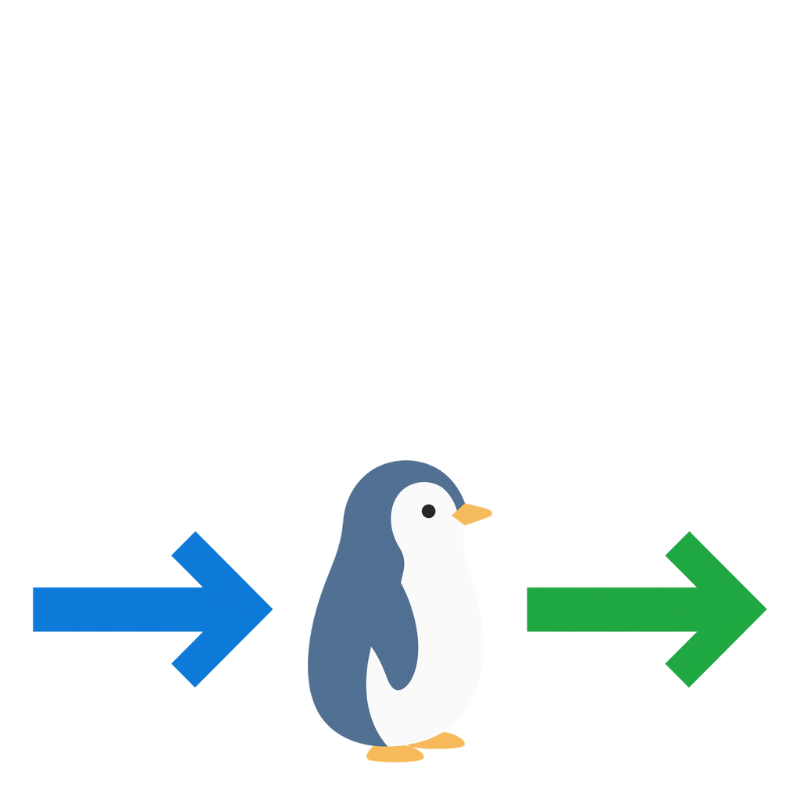

  

# LinuxSCP

LinuxSCP is a free, open-source file transfer client for Debian GNU/Linux. It
connects to SFTP servers over SSH and transfers files from a command line, a
script or an interactive prompt. The client is built from source with `make`
and packaged as a `.deb`.

The logo is a fairy penguin (*Eudyptula minor*, the smallest penguin) with a
blue arrow arriving from the left and a green arrow leaving to the right -
downloads in, uploads out.

## Requirements

Debian 12 (bookworm) or newer, on any architecture with a GCC or Clang
toolchain. The client only needs the C library and POSIX threads, so there are
no third-party runtime libraries to install.

    sudo apt install build-essential dpkg-dev

## Building

    make -C source/linux            # -> source/linux/build/linuxscp
    make -C source/linux check      # builds and runs the unit tests
    make -C source/linux clean

To build a Debian package:

    dpkg-buildpackage -b -us -uc    # -> ../linuxscp_1.0-1_<arch>.deb
    sudo dpkg -i ../linuxscp_1.0-1_*.deb

See [`docs/debian.md`](docs/debian.md) for details, usage and the verified
feature list. The manual page is [`docs/linuxscp.1`](docs/linuxscp.1).

## Usage

    linuxscp -batch -script=script.txt
    linuxscp -batch -command="open sftp://user@example.com/ /data ; ls ; get * /tmp"

## Linux port scope and roadmap

The Debian build is currently a **console SFTP client**, providing high
scripting compatibility with WinSCP. It supports SSH/SFTP sessions, host-key
checking, ssh-agent/private-key/password authentication, scripted and
interactive commands, recursive directory transfers (`get -r`, `put -r`),
directory synchronization (`synchronize`), and single-file or wildcard transfers.
The supported commands and current validation status are listed in
[`docs/debian.md`](docs/debian.md).

Remaining for full upstream parity: SCP, FTP/FTPS, WebDAV, Amazon S3, transfer
resume, and a graphical desktop interface. This repository contains the Debian
front end and shared protocol core, focused on Linux server and workstation
workflows.

## Repository layout

    /debian                 Debian packaging (control, rules, changelog, copyright)
    /docs                   build and usage documentation, manual page
    /libs/putty             POSIX platform layer and charset code vendored from
                            PuTTY 0.85 (libs/putty/unix, libs/putty/charset)
    /logo                   project logo artwork
    /source/linux           the linuxscp client: front end, SFTP glue, tests
                            and the Makefile
    /source/putty           PuTTY SSH/SFTP core (platform-neutral)

## Naming

Everything is branded `LinuxSCP`: the `linuxscp` executable, the `linuxscp(1)`
manual page and the Debian package. The upstream PuTTY and WinSCP code keeps
its original attribution, see [`license.txt`](license.txt).

## Licence

The code is distributed under the GNU General Public License version 3, with
the attribution and third-party notices described in
[`license.txt`](license.txt). The logo artwork in `/logo` is not under the GPL;
see section B of that file.
